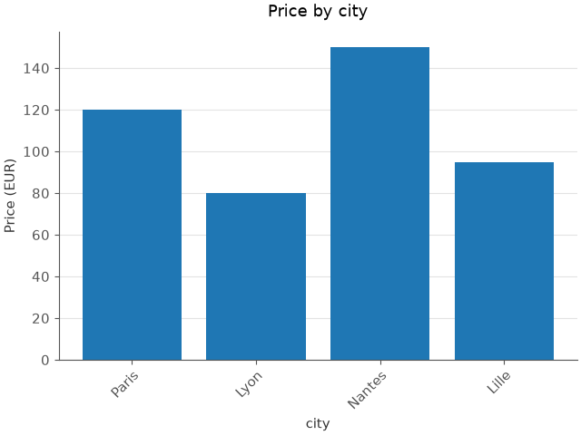

# numdaplot

| | |
| --- | --- |
| About | [](https://github.com/Ryieru) [](https://github.com/Ryieru/numdaplot/blob/main/LICENSE) |
| Package | [](https://pypi.org/project/numdaplot/) [](https://pypi.org/project/numdaplot/) [](https://peps.python.org/pep-0561/) |
| Testing | [](https://github.com/Ryieru/numdaplot/actions/workflows/tests.yml) [](https://codecov.io/gh/Ryieru/numdaplot) |

Numdaplot is a typed API for arrays, tables and plots, built on numpy, pandas and matplotlib.

- **Documentation:** https://ryieru.github.io/numdaplot/
- **Changelog:** https://ryieru.github.io/numdaplot/changelog/
- **Source code:** https://github.com/Ryieru/numdaplot
- **Bug reports:** https://github.com/Ryieru/numdaplot/issues

It provides:

- `Array`: values of one type in one or several dimensions, with operators, selections, sorting and more
- `Table`: columns read from and written to files, with filters, aggregations, pivots, joins and more
- `Rule`: tests applied to values, such as `Greater`, `Between`, `IsMissing` and more
- `Statistic`: calculations over values, such as `Sum`, `Mean`, `Quantile` and more
- `MathFunction`, `Distribution`: math functions and random values for arrays
- `DateFormat`, `TimeZone`, `TimeFunction`: dates, time zones, periods, durations and more
- `Plot`, `Chart`, `PlotStyle`: line, bar, scatter, histogram, box, pie, heatmap and missing value plots, and their look
- `Figure`, `FigureStyle`: several plots on a grid, and the title and size of the whole
- `NumdaplotError`, `NumdaplotWarning`: precise errors and warnings

## Example

```python
import numdaplot as ndp

prices = ndp.Array.from_list([12.5, 8.0, None, 30.0])
taxed_prices = prices * 1.2
taxed_prices
# Array([15. ,  9.6,  nan, 36. ], dtype=FLOAT64)

high_prices = taxed_prices.select(ndp.Greater(10))
high_prices.to_list()
# [15.0, 36.0]

mean_price = taxed_prices.compute(ndp.Mean())
mean_price.to_value()
# 20.2

sales = ndp.Table.from_csv("sales.csv")
sales.preview()
#      city price
#      TEXT INT64
# 0   Paris   120
# 1    Lyon    80
# 2  Nantes   150
# 3   Lille    95

expensive = ndp.Condition(rule=ndp.Greater(100), columns=["price"])
expensive_sales = sales.filter(ndp.Filter(conditions=[expensive]))
expensive_sales.preview()
#      city price
#      TEXT INT64
# 0   Paris   120
# 1  Nantes   150

chart = ndp.BarChart(x="city", y=["price"])
style = ndp.PlotStyle(title="Price by city", y_label="Price (EUR)")
plot = ndp.Plot.bar(sales, chart, style)
plot.save("prices.png")
# prices.png is the image below
```



## Installation

```
pip install numdaplot
```

The `excel` extra reads and writes Excel files, the `parquet` extra reads and writes Parquet files:

```
pip install "numdaplot[excel,parquet]"
```

## License

BSD-3-Clause, see [LICENSE](https://github.com/Ryieru/numdaplot/blob/main/LICENSE).
